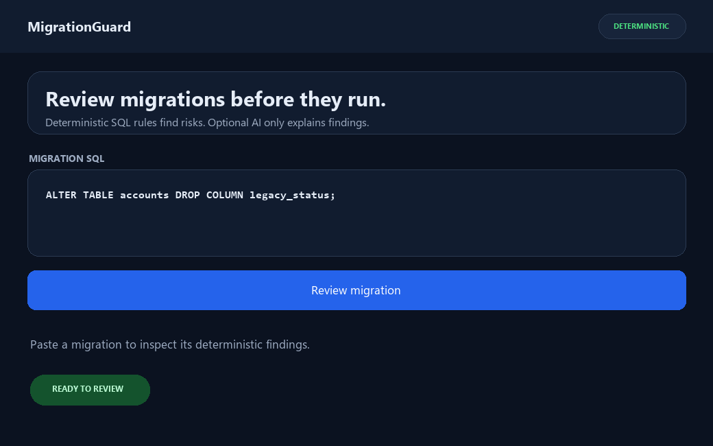

# MigrationGuard

MigrationGuard reviews PostgreSQL migrations before they run. Its rules use
SQLGlot's PostgreSQL parser to identify migration risks deterministically.
An optional LangChain explainer can describe those existing findings and
suggest safer SQL; it cannot add or remove findings.

## Before and after

A regular index build may block writes while it runs:

```sql
CREATE INDEX users_email_idx ON users (email);
```

For a PostgreSQL deployment that supports concurrent index builds, use:

```sql
CREATE INDEX CONCURRENTLY users_email_idx ON users (email);
```

`CREATE INDEX CONCURRENTLY` must not run inside a transaction block. Confirm
that your migration runner supports executing it outside a transaction.

## Setup

Requires Python 3.11 or later.

```powershell
py -3.11 -m venv .venv
.\.venv\Scripts\Activate.ps1
python -m pip install --upgrade pip
python -m pip install -e .
```

On macOS or Linux, replace the virtual-environment activation command with
`source .venv/bin/activate`.

The optional explainer uses the LangChain OpenAI integration. Copy
`.env.example` to `.env`, then set `OPENAI_API_KEY` there if you want to use it.
The key is never embedded in the project or sent as migration content.

## CLI

```text
migrationguard check path/to/migration.sql
migrationguard check migrations/
migrationguard check path/to/migration.sql --config migrationguard.yaml
migrationguard check path/to/migration.sql --explain
```

The directory form checks its `.sql` files recursively. Findings are printed
with severity colors; `--report-file report.md` also writes a Markdown report.
`--explain` explicitly opts in to LLM explanations. For each finding, the
explainer receives only its rule ID, SQL snippet, and deterministic message,
never the full migration. Without an API key or if the model call fails,
MigrationGuard keeps and reports the deterministic findings.

The CLI returns exit code `1` for `BLOCK`, `0` for `REVIEW` or `SAFE`, and `2`
for invalid SQL or configuration errors.

## Deterministic rules

| Rule ID | Risk detected | Default severity |
| --- | --- | --- |
| `drop_table_column` | `DROP TABLE` or `DROP COLUMN` can permanently remove data | High |
| `truncate_table` | `TRUNCATE` removes all rows | High |
| `add_not_null_without_default` | Adding a `NOT NULL` column without a default can fail on existing rows | High |
| `create_index_without_concurrently` | A regular index build can block writes | Medium |
| `alter_column_type` | Changing a column type may rewrite a table | Medium |
| `rename_column_or_table` | Renaming can break code that still uses the old name | Medium |
| `add_constraint_without_not_valid` | Adding a foreign-key, unique, or check constraint can scan existing rows under lock | Medium |
| `update_delete_without_where` | An `UPDATE` or `DELETE` without `WHERE` affects every row | High |

Verdicts are deterministic: any high finding is `BLOCK`; otherwise any medium
finding is `REVIEW`; otherwise the migration is `SAFE`. Edit
[`migrationguard.yaml`](migrationguard.yaml) to disable a rule or change its
severity.

## Streamlit app

```text
streamlit run app.py
```

Paste or upload a migration to see its verdict, findings table, and expandable
SQL details. Enable the optional explanation checkbox to request LLM
explanations and safer rewrites.

## GitHub Actions

The workflow in `.github/workflows/migrationguard.yml` runs for pull requests
that change SQL files under `migrations/`. It checks changed files, posts or
updates a report comment, and fails when the verdict is `BLOCK` or SQL is
invalid. It requests `pull-requests: write` for comments. GitHub restricts
write access for fork-originated pull requests, so those checks run without a
comment. The separate `tests.yml` workflow runs pytest on Python 3.11.

## Screenshot

The animated preview shows a deterministic review and its BLOCK finding:



## Sample migrations

- [`migrations/001_safe.sql`](migrations/001_safe.sql) demonstrates a safe
  table creation, concurrent index build, and bounded update.
- [`migrations/002_risky.sql`](migrations/002_risky.sql) intentionally
  demonstrates findings and returns `BLOCK`.
